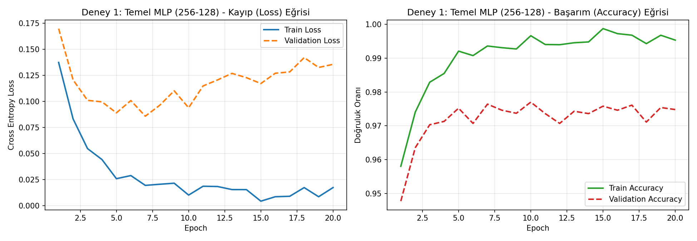
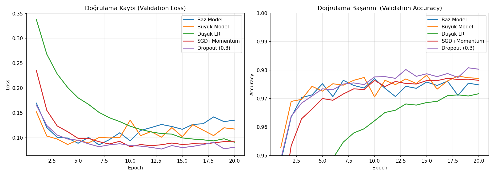
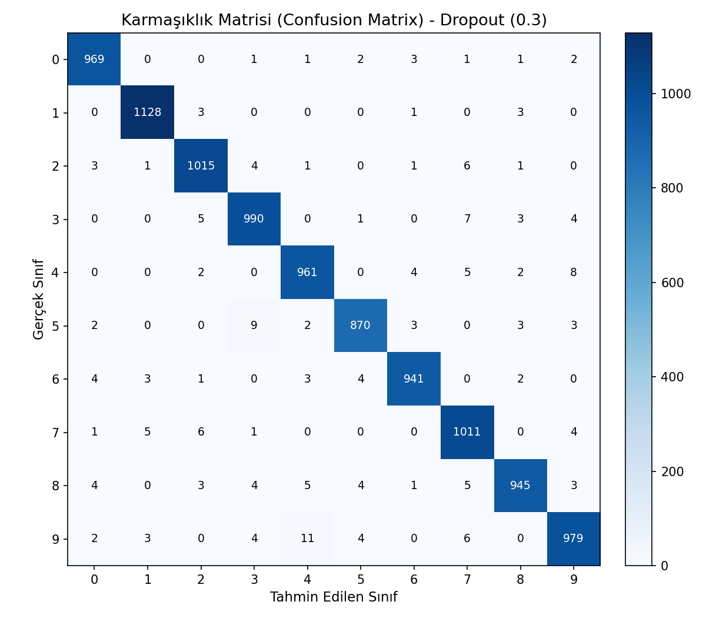
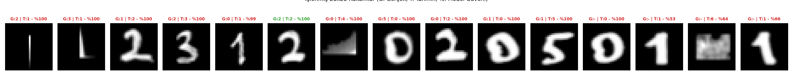

# Derin Öğrenme Ödev 1 - Sonuç Raporu

* **Öğrenci No:** `23120205011`
* **Model Mimarisi:** Multi-Layer Perceptron (MLP)

## 1. Deney 1: Temel MLP Sonuçları
- Mimari: 784 -> 256 -> ReLU -> 128 -> ReLU -> 10
- Optimizer: Adam (lr=0.001) | Batch: 128 | Epoch: 20 | Seed: 42

| Metrik | Değer |
|---|---|
| Son Epoch Train Loss | 0.0172 |
| Son Epoch Val Loss | 0.1354 |
| Son Epoch Train Acc | 0.9953 |
| Son Epoch Val Acc | 0.9748 |
| En İyi Epoch (Min Val) | 7 |
| Baz Model Test Accuracy | 0.9790 |
| Toplam Eğitim Süresi | 61.9 sn |

## 2. Hiperparametre Karşılaştırması
| Konfigürasyon | Parametre | En İyi Epoch | Train Loss | Val Loss | Train Acc | Val Acc | Süre (s) |
|---|---|---|---|---|---|---|---|
| Baz Model | 235146 | 7 | 0.0193 | 0.0857 | 0.9936 | 0.9764 | 61.9 |
| Büyük Model | 535818 | 4 | 0.0308 | 0.0864 | 0.9906 | 0.9743 | 123.8 |
| Düşük LR | 235146 | 20 | 0.0303 | 0.0911 | 0.9931 | 0.9717 | 56.3 |
| SGD+Momentum | 235146 | 10 | 0.0133 | 0.0820 | 0.9980 | 0.9764 | 46.2 |
| Dropout (0.3) | 235146 | 13 | 0.0133 | 0.0773 | 0.9960 | 0.9802 | 68.1 |

Seçilen Final Model: **Dropout (0.3)**

## 3. Nihai Test Seti Başarımı (Dropout (0.3))
- Test Loss: 0.0741 | Test Accuracy: %98.09
- En Çok Karışan Çiftler: [(9, 4, 11), (5, 3, 9), (4, 9, 8), (3, 7, 7), (2, 7, 6)]

## 4. Kendi El Yazısı Sonuçları (Öğrenci No)
- Gerçek Numara: `23120205011`
- Tahmin Edilen : `112312402050161`
- Doğruluk      : 1/11 (%9.1)

